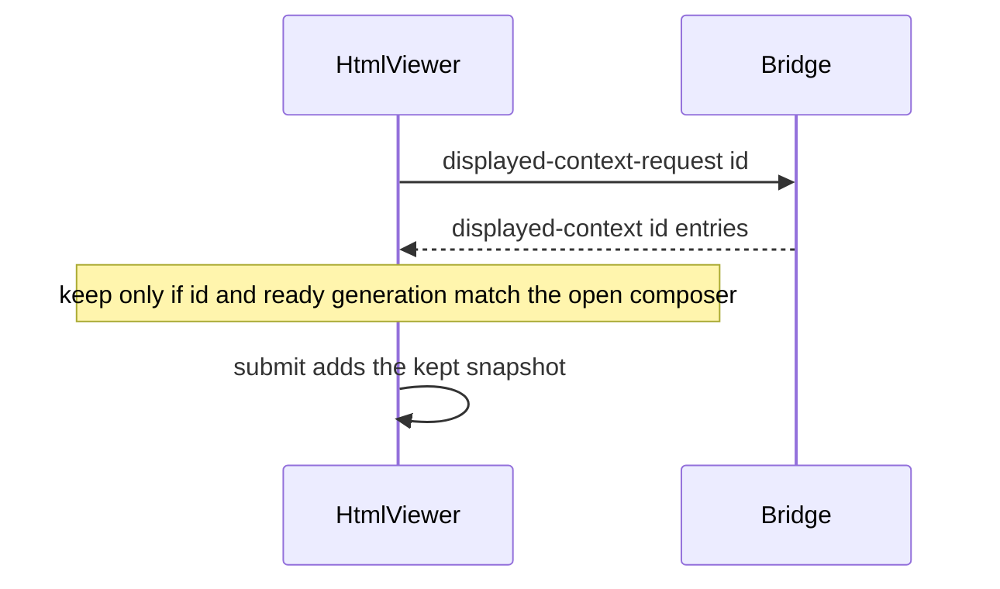

# Displayed Context on HTML Annotations

## Context

An HTML annotation does not record which simulated state the page showed when the comment was made. A prototype can
show a cart as empty or full at the same URL, and the comment loses that fact.

The existing fields do not fill this gap:

- `pageUrl` names a live route. The parent stamps it, and only for live sessions.
- `elementContext` describes the target element. Plain text selections and global comments never get it.

Plannotator has no PRD, ADR, or glossary. `packages/ui/README.md` and `packages/ui/HANDOFF.md` own the host contract
and get updated in this PR.

## Objective

When a host enables it, every HTML annotation carries a small snapshot of labels that the page declares on its root
element. A comment started in state A keeps A after the page changes to B. The contract is generic, bounded, and
optional. Hosts that do not enable it, including every Plannotator surface, stay byte-for-byte unchanged.

## Approach

### Host-chosen labels, declared by the page

**Owner decision:** the prototype declares and updates explicit labels. The host chooses which labels Plannotator reads.
Plannotator reports them; it does not infer state.

```text
host prop:   [{ key: "screen", attribute: "data-demo-screen" },
              { key: "state",  attribute: "data-demo-state" }]
page root:   <html data-demo-screen="cart" data-demo-state="empty">
annotation:  displayedContext = { entries: [{ key: "screen", value: "cart" },
                                            { key: "state",  value: "empty" }] }
```

The bridge reads only the configured attributes on `document.documentElement`. The keys are examples, not reserved
names.

> [!NOTE]
> **Seam convention**
>
> `packages/ui/AGENTS.md` requires new host behavior to arrive as an optional seam whose default reproduces today's
> behavior. Plannotator's own hosts pass nothing. This PR does not enable the feature in `plannotator annotate`, the
> Inbox, or live sites.

### Configuration reaches the bridge like other runtime settings

`HtmlViewer` gets an optional prop. After each bridge `ready`, the parent sends it in a new `set-*` message, the same
way it sends `set-input-method` and `set-annotate-mode` (`HtmlViewer.tsx` effects keyed on `iframeReadyVersion`).

This works for inline srcdoc, `bridgeScriptUrl`, and live frames. Injecting it into `srcdoc.ts` would miss live mode;
`__plannotatorLiveConfig` would reach only live mode. So `srcdoc.ts` does not change.

The parent validates the configuration once with the core parser. Invalid configuration disables capture and logs one
console warning. It never blocks rendering or annotation.

### One snapshot travels with each target

```text
select target in state A
  bridge posts selection + displayedContext A
    parent parses and bounds it, stores it with that target
      page changes to B
        submit -> annotation still carries A
```

The bridge adds the snapshot at every existing capture point:

- `handleSelection` — drag, touch, and vim text selections. These carry no element context today.
- `annotateElement` — pinpoint click, click-to-select, touch hold, keyboard pinpoint, parent/child step.
- `toggleMultiTarget` — shift-click extra targets, in `plannotator-bridge-multi-target-added`.

The parent keeps the snapshot next to the target, the way `pendingContextRef` and `HtmlDraftTarget.context` keep element
context. Extra targets keep their own snapshot. Removing the primary target promotes the next target's snapshot with its
anchor and text. Cancel, reselection, and document replacement clear it.

`useHtmlAnnotation.ts` builds annotations in five places, and each copies `elementContext` by hand. Each must also copy
`displayedContext`:

| Constructor | Output |
| --- | --- |
| host draft (`onHostDraft`) | `HostDraft.annotation` |
| `handleAnnotate` | deletion annotations |
| `commitComposerDraft` | built-in comments and extra targets |
| `applyQuickLabel` | quick labels and looks-good |
| `peekComment` | `peekComment()` for hosts |

**Reopen keeps the original snapshot.** `reopenComment` re-pins a comment that a host saved mid-draft. The answer
from the bridge is a fresh selection. For that answer, the draft keeps the reopened annotation's `displayedContext`
instead of the fresh one, because the words were written in the earlier state.

### Global comments capture when the composer opens

**Owner decision:** global comments carry page context too, captured when their composer opens, not at submission.



This copies the existing `rich-copy-request` pattern: a request id, a map of open requests, and replies with unknown
ids dropped. The parent records the `iframeReadyVersion` with the request.

A reply is ignored when the composer closed, a different composer opened, a new `ready` arrived, or the document changed.
If the reply has not arrived at submission, the comment is sent without context. Submission never waits.

The global composer keeps one draft per document. Reopening a kept draft captures the state at that opening.

### Bounds and validation live in core

`packages/core/html-anchor.ts` owns the type, the configuration parser, the snapshot parser, and the limits.
`@plannotator/ui/types` and `@plannotator/ui/components/html-viewer` re-export them; there is no mirrored validator.
The bridge is a string script, so it carries a small mirrored cap, as it does for element context today.

**Reviewable limits:**

- At most 8 entries.
- Keys: 1–40 characters, letters, digits, `_`, `-`, `.`, starting with a letter. Unique.
- Attributes: valid lowercase `data-*` names, at most 64 characters. Unique.
- Values: non-empty strings, at most 160 UTF-16 units.
- The whole snapshot: at most 2 KiB of UTF-8 JSON.

Missing or empty attributes are left out. A malformed or over-limit snapshot is dropped whole; the annotation survives.
Values are never truncated, because a cut identifier can name a different state. Form values and nested state are
never collected.

### Existing output boundaries keep the field

`buildPersistedHtmlAnchor` and `projectHostThreads` carry `displayedContext` on the primary and `displayedContext` on
each target. New keys serialize after the existing ones, so rows without context stay byte-identical. This matches the
key-order rule in HANDOFF "Element context through the host seam".

The 16 KiB budget sheds optional metadata before targets. The new order:

```diff
 1. quote down to its 400-char floor
 2. per-target element contexts, from the end
 3. primary element context
+4. per-target displayed contexts, from the end
+5. primary displayed context
 6. targets, from the end
 7. rest of the quote
```

Element description goes first because a page can describe its element again on the next click; the state label cannot
be recovered later. Shedding is silent; the `droppedTargets` counters keep their meaning.

Feedback export (`packages/ui/utils/parser.ts`) prints one escaped line for the primary, global comments included, and
one per extra target. The exact wording is the Engineer's choice, styled like `elementContextExportBlock`. Context-free
output stays byte-identical.

### Boundaries deliberately left alone

| Boundary | Why it does not change |
| --- | --- |
| External annotations API (`external-annotation.ts`, Bun and Pi servers) | Agents do not author displayed context. POST never carried HTML fields; PATCH merges, so an existing value survives. No server change, so the two-runtime rule is not touched. |
| Feedback archive structured record | The exported feedback text already carries the line. No Plannotator host enables the field. |
| Inbox store | Passes annotations through unchanged. |
| URL sharing | Drops HTML anchor metadata on purpose; it drops this too. |
| WebMCP replies | Copy anchors, not element context; same rule here. |

A page callback could report state that is not in attributes. It would add execution, error handling, and a larger
API, and an async callback could mix selection and submit state. It is set aside.

Context is descriptive and page-controlled. It grants no authority, picks no revision, and does not replay state.

## Expected Change Surface

The boundaries this change is expected to touch. This list is guidance, not an allowlist: verify the real footprint
during implementation and change whatever the Implementation Steps need, including files not named here. Stop and report
only when discovery changes approved intent — the change reaches another subsystem, public behavior or architecture
shifts, migration or compatibility risk grows, or the Verification Plan no longer proves the objective.

- `packages/core/html-anchor.ts` — type, config and snapshot parsers, limits, persistence and projection.
- `packages/core/html-anchor.test.ts` — round trip, key order, shed order, old-row compatibility.
- `packages/ui/types.ts` — optional fields on `Annotation` and `HtmlAnnotationTarget`.
- `packages/ui/components/html-viewer/bridge-script.ts` — attribute reader at each capture point; the `set-*` and
  request/reply handlers.
- `packages/ui/components/html-viewer/useHtmlAnnotation.ts` — message parsing, per-target snapshots, promotion, the
  five constructors, reopen, and the global request.
- `packages/ui/components/html-viewer/HtmlViewer.tsx` — the prop, the `set-*` effect, global composer capture.
- `packages/ui/components/html-viewer/index.ts` and other supported entry points — re-exports.
- `packages/ui/utils/parser.ts` — the export line.
- Generated bridge asset from `build:bridge-assets` — must match the new bridge source.
- `srcdoc.test.ts`, `htmlPinpointProtocol.test.tsx`, `HtmlViewer.globalCommentDraft.test.tsx`, `parser.test.ts` — new
  behavioral cases through the real bridge and hook.
- `packages/ui/README.md`, `packages/ui/HANDOFF.md` — contract, limits, timing, trust limits, host example.

No RunWield code, server endpoint, persistence backend, share payload, or general DOM-state capture changes.

## Reuse Opportunities

- `handleSelection`, `annotateElement`, `toggleMultiTarget` in the bridge — existing capture points.
- `parseBridgeMessage`, `HtmlDraftTarget`, `pendingContextRef`, `applyTargetRemoval` — carry target data today.
- `rich-copy-request` / `richCopyRequestsRef` — request id, timeout, unknown-id drop.
- `set-input-method` effect keyed on `iframeReadyVersion` — runtime configuration delivery.
- `parseHtmlElementContext` and its budget tests — parser and byte-budget patterns.
- `elementContextExportBlock`, `additionalTargetsExportBlock`, `safeInline` — escaped agent-facing lines.

## Implementation Steps

1. **Core owns a bounded contract.** `@plannotator/core/html-anchor` exports `HtmlDisplayedContext`, a configuration
   parser, a snapshot parser, and the limits above. The snapshot parser returns `undefined` for non-records, unknown
   shapes, duplicate keys, over-limit counts or strings, and snapshots over 2 KiB; it never truncates. The config parser
   rejects duplicate keys or attributes and non-`data-*` names. `Annotation.displayedContext` and
   `HtmlAnnotationTarget.displayedContext` are optional in `@plannotator/ui/types`, and the UI re-exports the core
   parsers unchanged.
2. **The host enables capture.** `HtmlViewer` accepts the optional prop. After each `ready`, the parent posts a
   `set-*` message with the validated list. Without the prop, or with invalid configuration, no new message carries
   context and every existing test output is unchanged.
3. **The bridge captures with the target.** Selection messages from `handleSelection` and `annotateElement`, and
   `multi-target-added` messages, include the configured root attributes read at that moment. The bridge answers a
   `displayed-context-request {id}` with the same reader. No `BRIDGE_PROTOCOL_VERSION` bump: an older bridge asset
   ignores the request and the parent sends no context.
4. **Each draft keeps its own snapshot.** `parseBridgeMessage` parses the snapshot with the core parser. The primary
   target and each extra target store their snapshot. Primary removal promotes the next target's snapshot. Cancel,
   reselection, and document replacement clear it. A later page change does not replace it.
5. **Every output carries the right snapshot.** Host drafts, `handleAnnotate` deletions, `commitComposerDraft`,
   `applyQuickLabel`, and `peekComment` include `displayedContext` on the primary and on each extra target. A reopened
   comment keeps its annotation's snapshot, not the fresh re-pin.
6. **Global comments capture on open.** Opening the global composer sends one request. A reply counts only if its id
   and ready generation match the open composer. `handleGlobalCommentSubmit` adds the kept snapshot. A missing, late,
   or invalid reply leaves the comment valid and context-free.
7. **Host helpers round-trip it.** `buildPersistedHtmlAnchor` and `projectHostThreads` carry the primary and per-target
   fields, apply the shed order above, and serialize rows without context byte-identically to today.
8. **Feedback shows it.** The export prints an escaped displayed-context line for the primary, global comments, and
   each extra target. Annotations without it export byte-identically.
9. **Docs match the code.** `packages/ui/README.md` and `packages/ui/HANDOFF.md` describe the prop, the attribute source,
   capture timing for each comment kind, limits, shed order, trust limits, the left-alone boundaries, and a host
   example. HANDOFF notes that core must publish before UI. Examples use only real exports.

## Approval Confirmation

No Work Records are proposed for supersession.

Owner decisions: global comments are included; they capture when the composer opens; labels are declared by the page
and chosen by the host.

Reviewable assumptions: names, limits, whole-snapshot omission, shed order, the reopen rule, and the boundaries left
alone.

## Verification Plan

Install with `bun install --frozen-lockfile` under Bun 1.4.4. Run focused tests through the sandbox runner:

```sh
bun run test:sandbox packages/core/html-anchor.test.ts packages/ui/utils/parser.test.ts \
  packages/ui/components/html-viewer/srcdoc.test.ts \
  packages/ui/components/html-viewer/htmlPinpointProtocol.test.tsx \
  packages/ui/components/html-viewer/HtmlViewer.globalCommentDraft.test.tsx \
  packages/ui/components/html-viewer/bridgeAsset.test.ts
bun run --cwd packages/ui build:bridge-assets
bun run typecheck
bun run --cwd packages/ui smoke:package
```

**Timing discriminator, target comments.** In `srcdoc.test.ts`, run the real bridge with the configuration set. Set
the root to `empty`, select text, set the root to `full`, then pass the message through the parent parser and export.
The result says `empty`. A new selection says `full`. This fails for a submit-time read, a type-only field, or a
pass-through that never reads attributes.

**Timing discriminator, global comments.** Mount `HtmlViewer` with the prop. Open the global composer in `empty`,
change to `full`, submit. The emitted annotation says `empty`; the next composer says `full`. Close and reopen while a
reply is pending, and replace the document while a reply is pending: the old reply attaches to nothing.

**Every output.** Through the mounted hook, assert the snapshot on: text selection, textless pin, keyboard pinpoint,
quick label, deletion, `onHostDraft`, `peekComment`, extra targets in different states, primary removal and promotion,
cancel-then-reselect (only the new state survives), and reopen (keeps the saved state).

**Hostile input.** Missing attributes, unconfigured attributes on the root, non-string payloads, duplicate keys,
too many entries, an over-long value, a multibyte value over 2 KiB, and malformed messages. The annotation survives;
the snapshot is dropped whole; no unconfigured attribute appears.

**Host helpers.** Persist and project a multi-target annotation with both context kinds: exact round trip. A tight
`maxBytes` sheds in the stated order. A row without displayed context serializes to the same bytes as before
(extend the existing wire-fingerprint test).

**Protected behavior.** Existing element-context, geometry, host draft, live-route, reopen, rich-copy, URL-sharing, and
global-draft tests must keep passing unchanged. No behavior is retired.

**Not this PR.** Combined testing with restrictions waits until both PRs are available.

**AI review.** Follow each constructor, promotion, reopen, persistence helper, and export. A field that exists in a
type but disappears at a boundary fails review.

> **Question (browser-proof):** How should this PR prove the flow in a real browser? Plannotator's own hosts never set the new prop, so the existing annotate Playwright specs cannot reach it.
>
> **Answer:** Recommended: happy-dom tests through the real bridge and mounted HtmlViewer, plus a headed manual check with a local, uncommitted host edit. No new Playwright harness. (answered in review)

## Edge Cases & Considerations

- **The page can lie.** Labels describe; they do not prove. Hosts must not treat them as revision or authorization.
- **Prototype code shares the bridge's JavaScript realm.** It could post fake messages. The parent's parser still
  bounds them; trust stays descriptive.
- **Configuration arrives after `ready`.** A selection made in the first moment after load has no context. Accepted.
- **Different targets, different states.** Each target keeps its own snapshot; nothing recaptures at submit.
- **Tight host budget.** The helper can drop displayed context silently. The original annotation callback still has it.
- **Publish order.** Core changes, so core publishes before UI, as with element context.
- **Domain language.** "Displayed context" is a new public type name. Plannotator has no glossary; README and HANDOFF
  define it.
